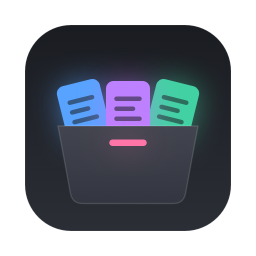

<p align="center">
  
</p>

<h1 align="center">PeekBox</h1>

<p align="center">
  <strong>Look inside archives before you extract them</strong><br>
  A native archive browser and extractor for macOS.
</p>

<p align="center">macOS 14 or later · Apple Silicon</p>

## Features

- **Browse first.** Opening an archive shows its contents in a Finder-style window: folders, sizes, dates and kinds, sortable by any column, with search across the whole archive.
- **Extract anywhere.** Extract everything or just the selected items, next to the archive, to Desktop, Downloads, Documents, a recent folder or any folder you choose.
- **Quick Look and drag out.** Press Space to preview a file, double-click to open it, or drag files and folders straight into Finder.
- **Every common format.** ZIP, RAR and RAR5, 7z, TAR, GZ, BZ2, XZ, ISO, CAB, LHA, XAR and CPIO, including multi-volume archives (`.part1.rar`, `.7z.001`, `.r00`).
- **Passwords.** Encrypted ZIP, RAR and 7z, including 7z archives with encrypted file names.
- **Safe extraction.** Files land next to the archive only after extraction succeeds; paths that try to escape the destination are contained.
- **Default app.** One click makes PeekBox the app Finder uses for archives.

## Build from source

Requires Xcode 16 or later and [XcodeGen](https://github.com/yonaskolb/XcodeGen).

```bash
./Scripts/install.sh   # build and install into /Applications
./Scripts/test.sh      # run the tests
./Scripts/package.sh   # test, build and pack dist/PeekBox-<version>.zip
```

The first build compiles the bundled 7-Zip console helper from its official source (`Scripts/build-7zip.sh`).

## Architecture

MVVM with SwiftUI: `Models`, `Services` (libarchive and 7-Zip engines behind protocols), `ViewModels` (`@Observable`, `@MainActor`) and `Views`.
Extraction uses the system libarchive and falls back to 7-Zip for what libarchive can't read.

## License

7-Zip is distributed under the GNU LGPL with the unRAR restriction; see `Vendor/7zip/License.txt`.
